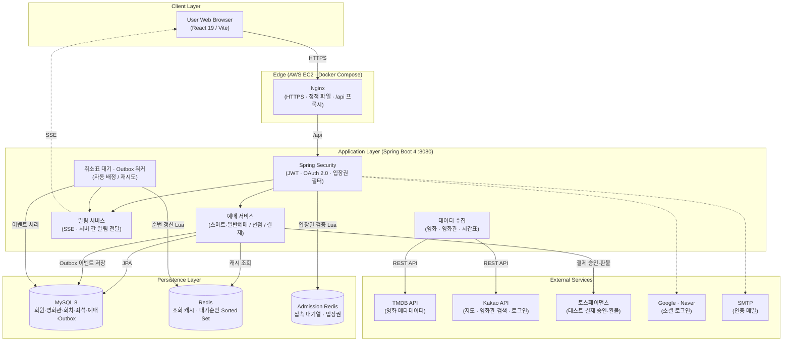
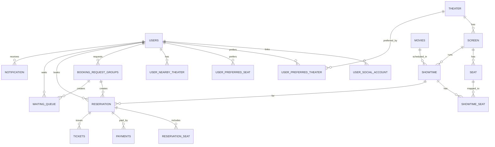

# SmartTicketing

> 최신 반영: 회원가입은 **이메일 인증 필수**이며, 예매 화면은 **Redis 접속 대기열**을 통과한 사용자만 이용합니다. 결제는 **토스페이먼츠 테스트 결제**로 서버 승인 후 확정되고, 취소표는 **Transactional Outbox** 워커가 대기자에게 자동 배정합니다.

## 최근 개선 사항

- 일반·소셜 회원가입 모두 이메일 인증 필수, 로그인 후 미완료 선호정보 설정 → 요청했던 화면으로 복귀
- 접속 대기열: 동시 입장 정원·초당 입장 한도 적용, 대기 인원에 따라 순번 갱신 주기 단축
- 토스페이먼츠 테스트 결제 연동: 서버 승인 결과로 결제 확정, 취소 시 환불 후 예매 취소
- 서버 간 알림 전달: 분산 서버 환경에서도 취소표 선점 알림을 SSE로 실시간 전달
- QR 티켓: 휴대폰으로 QR 인증 시 사용 완료 처리 및 `USED` 도장 표시
- 상영 시간표 자동 생성: 영화 인기 순위에 따라 상영관·회차를 배분
- 영화 상세: TMDB 기반 개봉일·장르·감독·출연진, 누적 관객수와 실시간 예매율 표시
- 백엔드를 `backend/` 디렉터리로 분리하고 빌드·배포 경로 정리

> 선호 영화관·좌석 기반 스마트예매와 취소표 자동 선점을 제공하는 영화 예매 웹 서비스


🌐 [**접속 링크**](https://smartticketing.duckdns.org)

## 프로젝트 소개

SmartTicketing은 **“집 근처 영화관, 가운데 뒤쪽 좌석, 2명”**처럼 선호 조건을 미리 저장해 두면, 날짜·시간대·인원만 골라도 조건에 맞는 좌석을 자동으로 찾아 주는 영화 예매 서비스입니다.

예매 가능한 좌석은 **5분간 선점**하고, 원하는 좌석이 없으면 **취소표 대기**에 등록해 두었다가 취소가 발생하는 즉시 자동으로 선점합니다. 많은 사용자가 몰리는 상황을 고려해 구역 단위 잠금, Outbox 이벤트, Redis 접속 대기열로 동시성과 안정성을 확보했습니다.

📅 **개발 기간** : 2026.09.28 ~ 2026.10.12 &nbsp;|&nbsp; 👥 **개발 인원** : 3인

## 주요 기능

### 회원 및 보안

| 기능 | 설명 |
| --- | --- |
| 회원가입 / 로그인 | 아이디·비밀번호 기반 가입, JWT 인증 |
| 소셜 로그인 | Google, Naver, Kakao OAuth 2.0 로그인 및 소셜 회원가입 |
| 이메일 인증 | 6자리 인증번호(10분 유효), 재발송·시도 횟수 제한 |
| 계정 찾기 | 가입 시 인증한 이메일로 아이디 찾기·비밀번호 변경 |
| 토큰 무효화 | 비밀번호 변경 시 기존 로그인 토큰 무효화 |
| 회원탈퇴 | 탈퇴 확인 후 인증 차단, 재가입 허용 |

### 선호정보 및 영화

| 기능 | 설명 |
| --- | --- |
| 선호 영화관 | Kakao 지도로 현재 위치 기준 주변 영화관을 찾고 선호 순위 저장 |
| 선호 좌석 | 선호 좌석 6개를 모두 순위대로 선택해야 저장 |
| 메인 영화 차트 | 상영작·상영예정작 분리, 누적 관객수·실시간 예매율 표시 |
| 영화 상세 | TMDB 기반 포스터, 관람등급, 개봉일, 장르, 감독, 출연진 |
| 상영 시간표 | 영화 인기 순위에 따라 상영관·회차 자동 배분 |

### 예매

| 기능 | 설명 |
| --- | --- |
| 스마트예매 | 선호 영화관·좌석 순위로 후보를 탐색하고 연석 우선으로 자동 선점 |
| 일반예매 | 회차·좌석 직접 선택, 스마트예매와 같은 좌석 재고 사용 |
| 좌석 선점 | 5분 선점 후 결제하지 않으면 자동 만료·반환 |
| 결제 | 토스페이먼츠 테스트 결제, 서버 승인 결과로 확정, 중복 요청 방지 |
| 예매 취소 / 복구 | 취소 시 환불 처리, 화면 이탈 후 진행 중인 예매 복구 |
| 취소표 대기 | 회차·구역별 대기 등록, 취소·만료 발생 시 대기 순번대로 자동 선점 |
| 알림 | 취소표 선점·예매 상태 변경을 SSE 실시간 알림으로 전달 |
| QR 티켓 | 예매 완료 티켓의 QR 인증으로 사용 완료 처리 |

### 접속 대기열

| 기능 | 설명 |
| --- | --- |
| 순차 입장 | Redis 대기열로 동시 입장 정원(기본 100명)·초당 입장 한도(기본 10명) 제어 |
| 입장권 검증 | 서버 필터에서 입장권을 검사해 대기열 우회 API 호출 차단 |
| 장애 대응 | 입장 제어 Redis 장애 시 `503` 반환으로 무제한 입장 방지 |

### 관리자

| 기능 | 설명 |
| --- | --- |
| 데이터 수집 | TMDB 영화 정보, Kakao 기반 서울 지역 영화관 수집 |
| 시간표 준비 | 날짜별 상영 시간표 생성 |
| 데이터 관리 | 영화·영화관·회차·좌석 데이터 조회와 삭제 미리보기·삭제 |
| 예매 테스트 | 관리자용 예매 실행 미리보기 및 일괄 실행 |

### 스마트예매 흐름

1. 로그인 후 선호 영화관과 선호 좌석 구역을 순위대로 저장합니다.
2. 영화, 날짜, 시간대, 인원을 선택하고 스마트예매를 요청합니다.
3. 서버가 선호 순위에 따라 영화관·회차·구역 후보를 탐색하고, 연석이 가능한 좌석을 우선으로 **선호 좌석 / 균형 추천 / 빠른 예매** 결과를 만듭니다.
4. 선택한 후보의 좌석을 5분간 선점하고 결제하면 예매가 확정됩니다.
5. 모든 후보에 빈 좌석이 없으면 취소표 대기에 등록하고, 취소가 발생하면 자동 선점 후 알림을 보냅니다.

<details>
<summary><strong>⚖️ 스마트 예매 결과 비교 (GIF)</strong></summary>


</details>

<details>
<summary><strong>🔔 취소표 자동 선점 (GIF)</strong></summary>


</details>

<details>
<summary><strong>🎫 QR 티켓 사용 (GIF)</strong></summary>


</details>

<details>
<summary><strong>⏳ 접속 대기열 (GIF)</strong></summary>


</details>

## 서비스 구조



## 핵심 설계

| 주제 | 문제 | 해결 |
| --- | --- | --- |
| 구역 단위 잠금 | 회차 전체 좌석을 잠가 다른 구역 요청까지 대기 | 잠금 범위를 **회차·구역과 선택 좌석**으로 축소, 잠금 후 재확인·재탐색 |
| Transactional Outbox | 취소와 배정을 한 요청에서 처리하면 트랜잭션이 길고 서버 중단 시 배정 누락 | 좌석 상태 변경과 이벤트를 같은 트랜잭션에 저장, 워커가 배정·재시도 |
| 대기순번 캐시 | 매 조회 DB 집계 비용, Redis만 쓰면 오래된 순번 반환 위험 | DB·Redis 버전이 일치할 때만 `ZCOUNT` 사용, 불일치·장애 시 DB로 전환 |
| 접속 대기열 | 동시 접속 증가 시 업무 API로 요청 집중, 대기 화면 우회 가능 | Lua로 정원 확인·입장권 발급을 원자 처리, 서버 필터에서 입장권 검사 |

<details>
<summary><strong>흐름도 보기</strong></summary>


</details>

## ERD




### ERD 테이블 설명

| 영역 | 테이블 | 역할 |
| --- | --- | --- |
| 계정 | `users`, `user_social_account`, `email_challenge` | 회원 계정, 소셜 계정 연결, 이메일 인증 이력 |
| 선호정보 | `user_preferred_theater`, `user_preferred_seat`, `user_nearby_theater` | 선호 영화관·좌석 구역 순위, 위치 기반 주변 영화관 |
| 영화관 | `theater`, `screen`, `seat` | 영화관, 상영관, 좌석 배치 |
| 영화·상영 | `movies`, `showtime`, `showtime_seat` | TMDB 영화 정보, 상영 회차, 회차별 좌석 상태 |
| 예매 | `booking_request_groups`, `booking_group_holds`, `reservation`, `reservation_seat` | 예매 요청 단위, 후보별 선점, 예매와 예매 좌석 |
| 결제·티켓 | `payments`, `tickets` | 토스 결제 승인·환불 정보, QR 티켓 |
| 취소표 대기 | `waiting_queue`, `waiting_zone_sequences`, `queue_counters` | 회차·구역별 대기 등록과 대기 순번 |
| 이벤트·운영 | `booking_outbox_events`, `booking_outbox_streams`, `booking_operations`, `booking_user_limits`, `notification` | Outbox 이벤트, 중복 요청 방지, 사용자별 예매 한도, 알림 |

`showtime_seat`는 회차와 좌석의 N:M 관계를 풀어낸 테이블로, 좌석별 선점·예매 상태를 회차 단위로 관리합니다. `booking_outbox_events`는 좌석 상태 변경과 같은 트랜잭션에 저장되어, 서버가 재시작되어도 취소표 배정 이벤트가 유실되지 않습니다.

## 기술 스택

| 구분 | 기술 |
| --- | --- |
| Backend | Java 21, Spring Boot 4, Spring Data JPA, Spring Security |
| Frontend | React 19, Vite, React Router |
| Database / Cache | MySQL 8, Redis, Lua |
| Auth / Realtime | JWT, OAuth 2.0 (Google·Naver·Kakao), Spring Mail, SSE |
| External API | TMDB, Kakao 지도·로컬, 토스페이먼츠 |
| Infra / CI·CD | AWS EC2, Docker Compose, Nginx, Certbot, GitHub Actions |
| Test | JUnit 5, Vitest, k6 |

## 실행 방법

### 준비

- Java 21, Node.js, MySQL 8, Redis
- 저장소 루트의 `.env` 파일(Git 제외)에 환경 변수 설정

| 환경 변수 | 용도 |
| --- | --- |
| `DB_URL`, `DB_USERNAME`, `DB_PASSWORD` | MySQL 연결 |
| `JWT_SECRET` | JWT 서명 |
| `REDIS_HOST`, `REDIS_PORT` | Redis 연결 |
| `TMDB_ACCESS_TOKEN` | TMDB 영화 정보 수집 |
| `KAKAO_MAP_REST_API_KEY`, `VITE_KAKAO_MAP_JS_KEY` | 서버 지도 API, 브라우저 지도 SDK |
| `TOSS_SECRET_KEY`, `VITE_TOSS_CLIENT_KEY` | 토스 테스트 결제 키 쌍 |
| `MAIL_HOST`, `MAIL_USERNAME`, `MAIL_PASSWORD`, `MAIL_FROM` | 인증 메일 SMTP |

### 실행

```powershell
# 백엔드 (저장소 루트에서)
.\scripts\dev\local.cmd

# 프런트엔드 (별도 터미널)
cd frontend
npm ci
npm run dev
```

실행 후 `http://localhost:5173`으로 접속합니다. 자세한 설정과 접속 대기열·결제·배포 옵션은 [개발 및 실행 문서](docs/development.md)를 참고하세요.

### 테스트

```powershell
.\backend\gradlew.bat -p backend test
npm --prefix frontend run test:core
```

## 프로젝트 구조

```text
backend/              Spring Boot 백엔드, 테스트, Gradle 빌드
frontend/             React 웹 화면과 프런트엔드 이미지
deploy/               Docker Compose, Nginx 설정, 배포·검증 스크립트
scripts/dev/          로컬 실행, Redis 설정, 개발 데이터 준비
scripts/benchmark/    성능 측정 실행기, k6 시나리오, 보고서 생성기
.github/workflows/    AWS 배포 및 데이터 초기화 워크플로
docs/development.md   개발·실행·배포 상세 안내
docs/images/          README 흐름도와 시연 GIF
docs/erd.png          ERD 이미지
```

## 팀원 소개

| 이름 | 역할 | GitHub |
| --- | --- | --- |
| 안정현 | 팀장 / 예매·동시성 | [ahnjh97](https://github.com/ahnjh97) |
| 이연화 | 영화 데이터 / 메인·시간표 | [dusghk0802](https://github.com/dusghk0802) |
| 주상혁 | 결제 / 인증 | [jusanghyeok](https://github.com/jusanghyeok) |

### 안정현 · 팀장 / 예매·동시성

- 스마트·일반예매, 취소표 대기와 자동 선점 구현
- 구역 단위 잠금, Transactional Outbox, 대기순번 캐시로 동시성 제어 및 성능 개선
- Redis 접속 대기열과 AWS 배포·CI/CD 구성

### 이연화 · 영화 데이터 / 메인·시간표

- TMDB 영화 정보 수집과 서버 시작 시 자동 가져오기, 관람등급 예외 처리
- 메인 영화 차트(상영작·상영예정작), 누적 관객수와 실시간 예매율 API
- 영화 상세 화면(개봉일·장르·감독·출연진)과 인기 순위 기반 상영 시간표 자동 생성
- ERD 설계, 선호 좌석 저장 규칙 개선, k6 부하 테스트 스크립트 작성

### 주상혁 · 결제 / 인증

- 토스페이먼츠 테스트 결제 승인·환불·재시도 흐름 구현
- (담당 내용을 채워 주세요)

## 한 줄 회고

> 팀원별 한 줄 회고를 작성해 주세요.

- **안정현**: “”
- **이연화**: “”
- **주상혁**: “”

## 보안 주의

`.env`, API 키(TMDB·Kakao·토스·OAuth), DB 비밀번호, SMTP 비밀번호, 측정 결과물은 Git에 올리지 않습니다. `VITE_`로 시작하는 변수는 브라우저에 공개되므로 서버 비밀 키를 넣지 마세요. 외부 공개 시 MySQL(3306)과 Redis(6379)를 인터넷에 직접 노출하지 마세요.
